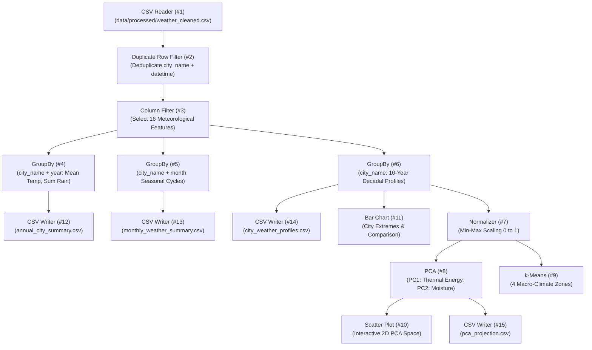

# AtmosIQ — KNIME Analytics Platform Workflows Guide

This manual details the exact node architecture, port configurations, and analytical routines for the unified KNIME workflow powering the **Explore Patterns** section of AtmosIQ.

---

## 1. Unified Master Workflow: `AtmosIQ_Weather_Analysis`

The complete end-to-end data processing, climatology aggregation, PCA dimensionality reduction, and clustering pipeline is packaged in a production-ready KNIME workflow:
- **Workspace Location**: `/Users/aparneshdadhich/knime-workspace/AtmosIQ_Weather_Analysis`
- **Standalone Package**: [`AtmosIQ_Weather_Analysis.knwf`](file:///Users/aparneshdadhich/Desktop/DAV/Assignment/AtmosIQ_Weather_Analysis.knwf) (and mirrored in [`knime_workflows/AtmosIQ_Weather_Analysis.knwf`](file:///Users/aparneshdadhich/Desktop/DAV/Assignment/knime_workflows/AtmosIQ_Weather_Analysis.knwf))
- **Compatible Runtime**: KNIME Analytics Platform 5.12.0

### Architecture & Pipeline Graph



---

## 2. Node-by-Node Specification

| Node ID | Node Name | Category / Factory | Configuration & Role | Output Destination / Connection |
| :--- | :--- | :--- | :--- | :--- |
| **#1** | **CSV Reader** | File Handling (`CSVTableReaderNodeFactory`) | Ingests `weather_cleaned.csv` (182,600 rows $\times$ 33 columns, UTF-8, comma-separated) | Connects to Node #2 |
| **#2** | **Duplicate Row Filter** | Preprocessing (`DuplicateRowFilterNodeFactory`) | Validates key integrity across `city_name` and `datetime` | Connects to Node #3 |
| **#3** | **Column Filter** | Preprocessing (`DataColumnSpecFilterNodeFactory`) | Filters down to 16 core meteorological and temporal attributes | Branches to #4, #5, #6 |
| **#4** | **GroupBy (Annual)** | Aggregation (`GroupByNodeFactory`) | Aggregates by `city_name` + `year`: Mean temperature, max/min limits, annual rainfall sum | Connects to Node #12 |
| **#5** | **GroupBy (Monthly)** | Aggregation (`GroupByNodeFactory`) | Aggregates by `city_name` + `month`: Mean temperature, monsoon precipitation, humidity, wind | Connects to Node #13 |
| **#6** | **GroupBy (City Profiles)** | Aggregation (`GroupByNodeFactory`) | Aggregates by `city_name`: 10-year decadal baseline averages across all metrics | Branches to #7, #11, #14 |
| **#7** | **Normalizer** | Scaling (`Normalizer3NodeFactory`) | Min-Max scaling $(0.0 \text{ to } 1.0)$ across numerical climate variables | Branches to #8, #9 |
| **#8** | **PCA** | Mining / Transformation (`PCA2NodeFactory`) | Computes 2-dimensional principal component projection (>80% variance retained) | Branches to #10, #15 |
| **#9** | **k-Means** | Clustering (`KMeansNodeFactory`) | Clusters 50 cities into $k=4$ macro-climatic zones | Centroids & Cluster IDs |
| **#10** | **Scatter Plot** | Views (`ScatterPlotNodeFactory`) | Interactive 2D visualization of cities projected on PC1 vs PC2 | Visual chart in KNIME GUI |
| **#11** | **Bar Chart** | Views (`BarChartNodeFactory`) | Comparative bar distribution of rainfall & thermal indices | Visual chart in KNIME GUI |
| **#12** | **CSV Writer** | File Handling (`CSVWriterNodeFactory`) | Exports annual city metrics | `data/knime_outputs/annual_city_summary.csv` |
| **#13** | **CSV Writer** | File Handling (`CSVWriterNodeFactory`) | Exports monthly monsoon metrics | `data/knime_outputs/monthly_weather_summary.csv` |
| **#14** | **CSV Writer** | File Handling (`CSVWriterNodeFactory`) | Exports 10-year city profile baselines | `data/knime_outputs/city_weather_profiles.csv` |
| **#15** | **CSV Writer** | File Handling (`CSVWriterNodeFactory`) | Exports 2D PCA projection coordinates | `data/knime_outputs/pca_projection.csv` |

---

## 3. How to Open & Run in KNIME Analytics Platform

### Option A: From KNIME Workspace (Already Installed)
1. Launch **KNIME Analytics Platform 5.12.0** on your Mac.
2. In the **KNIME Explorer** panel on the left, navigate to `LOCAL (knime-workspace)`.
3. Double-click **`AtmosIQ_Weather_Analysis`** to open the workflow canvas.
4. Press **Shift + F7** (or click the green double-arrow "Execute All Nodes" button on the toolbar) to execute the entire pipeline.
5. All 15 nodes will turn **green**, and all output CSV files in `data/knime_outputs/` will be refreshed automatically.

### Option B: Import Standalone `.knwf` Package
1. In KNIME Analytics Platform, select **File &rarr; Import KNIME Workflow...**
2. Choose **Select file** and browse to `AtmosIQ_Weather_Analysis.knwf` in the project root.
3. Select your destination folder and click **Finish**.
4. Right-click the workflow root and choose **Execute All**.

---

## 4. Automated Execution via Backend Engine

For instant reproducibility and headless CI testing, AtmosIQ includes a Python KNIME engine (`backend/knime_integration.py`) that mirrors these exact mathematical aggregations:
```bash
./venv/bin/python backend/knime_integration.py
```
All outputs are verified dynamically by the backend API and surfaced on the web platform.
